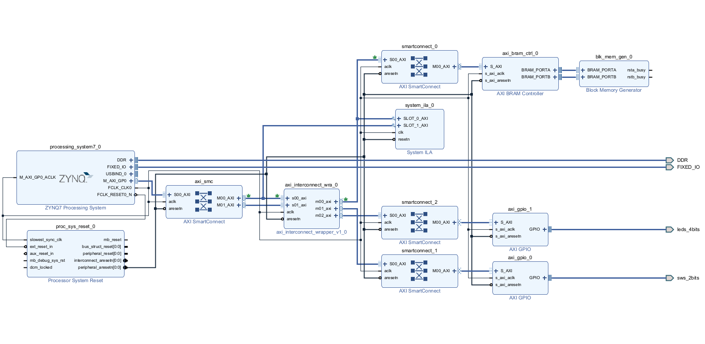

# AXI4 Interconnect: RTL, UVM Verification & Zynq Bring-Up

A custom **AMBA AXI4 interconnect** written from scratch in SystemVerilog (no vendor IP in the routing core), verified with a **UVM** testbench and SystemVerilog Assertions, packaged as an **IP-XACT** core, and brought up end-to-end on a **PYNQ-Z2 (Zynq-7020)** board with an ARM Cortex-A9 running bare-metal C.

Final-year B.Sc. project, Electrical & Electronics Engineering, Ariel University (2026).



---

## Highlights

- **2 masters × 3 slaves** AXI4 interconnect, all five channels (AW, W, B, AR, R)
- **Address decoder** with a fixed memory map and an internal **Default Slave** returning `DECERR` for unmapped addresses (prevents bus deadlock)
- **Round-robin arbiter** for simultaneous requests to the same slave
- **Transaction lock mechanism**: routing state is registered at the address handshake, so the data channel does not depend on the momentary `AWVALID`
- **UVM environment**: constrained-random sequence, driver, passive monitors, scoreboard, functional coverage, and smart dummy slaves
- **SVA assertions** for address-range routing, slave-select exclusivity, VALID/READY hold rules, `WLAST` integrity and `DECERR` response codes
- **Hardware-verified** on PYNQ-Z2: CPU writes and reads BRAM and drives two AXI GPIO blocks through the interconnect
- Timing met at **100 MHz** on XC7Z020 (WNS +0.922 ns, TNS 0 ns)

## Memory Map

| Slave | Device | Base Address | End Address | Size |
|---|---|---|---|---|
| S0 | AXI BRAM Controller | `0x4000_0000` | `0x4000_1FFF` | 8 KB |
| S1 | AXI GPIO 0 (switches) | `0x4001_0000` | `0x4001_FFFF` | 64 KB |
| S2 | AXI GPIO 1 (LEDs) | `0x4002_0000` | `0x4002_FFFF` | 64 KB |
| — | Default Slave | any other address | | returns `DECERR` / `0xDEADDEAD` |

Parameters: `ADDR_WIDTH = 32`, `DATA_WIDTH = 32`.

## Repository Structure

```
axi4-interconnect-uvm/
├── rtl/
│   ├── axi_interconnect.sv          # Decoder, arbiter, routing, default slave
│   ├── axi_interconnect_wrapper.sv  # Flat-port wrapper used for IP packaging
│   └── axi_if.sv                    # AXI4 interface + modports
├── tb/
│   ├── axi_pkg.sv                   # UVM package (compile first)
│   ├── axi_transaction.sv           # Sequence item with constraints
│   ├── axi_driver.sv
│   ├── axi_monitor.sv
│   ├── axi_scoreboard.sv
│   ├── axi_coverage.sv
│   ├── axi_env.sv
│   ├── axi_test.sv
│   └── tb_top.sv                    # Top: clock/reset, DUT, dummy slaves, SVA
├── sw/
│   └── main.c                       # Bare-metal test app (Vitis)
├── vivado/
│   └── block_design.tcl             # Recreates the Zynq block design
└── docs/
    └── block_design.png
```

## Verification

**Simulator:** Vivado XSIM (built-in UVM library)
**Run parameters:** 100 MHz clock, 200 ns reset, 50 constrained-random transactions per run

**What is checked:**
- Every transaction is routed to the correct slave (scoreboard compares the master-side expectation to what each slave actually received)
- Unmapped reads and writes return `DECERR` (negative testing)
- AXI handshake rules: VALID held until READY, transfer only on VALID && READY, `BVALID` only after both address and data are accepted
- Functional coverage over target slaves (S0/S1/S2/default) and read/write types

Final regression report: `UVM_ERROR: 0`, `UVM_FATAL: 0`.

### Running the simulation

1. Add `rtl/` and `tb/` as **Simulation Sources** in Vivado and set `tb_top.sv` as **Top**
2. **Simulation Settings** → `xsim.compile.xvlog.more_options` → add `-L uvm`
3. **Run Simulation** → **Run Behavioral Simulation**
4. Run for at least 2000 ns and check the Tcl Console for `UVM_ERROR`

## Hardware Integration (PYNQ-Z2)

The interconnect was packaged as IP-XACT and integrated in a Vivado block design with the Zynq PS (Cortex-A9), an AXI BRAM controller, two AXI GPIO blocks, and AXI SmartConnect for interface adaptation.

`sw/main.c` performs an end-to-end test over the interconnect:
1. Writes `0xDEADBEEF` to BRAM (S0), reads it back and reports pass/fail over UART
2. Runs a continuous loop that reads the switches (S1) and mirrors them to the LEDs (S2)

To rebuild the block design: in the Vivado Tcl console, `source vivado/block_design.tcl` (the packaged interconnect IP must be in the IP repository path).

**Resource utilization (full design, XC7Z020):** 8,231 LUTs (15%), 10,856 FFs (10%), 13.5 BRAM tiles (10%).

## Debugging Story

Bring-up initially produced a **silent CPU hang** with no error message. It turned out to be **four independent bugs**, each of which alone caused the exact same symptom, so fixing any one of them changed nothing:

1. **Missing burst signals in the packaged interface.** `WLAST` was not exposed, so Vivado tied it to 0 and the BRAM controller saw an endless burst and never returned `BVALID`.
2. **Routing collapse.** Data-channel routing depended on the arbiter grant, which was derived from `AWVALID`. A compliant master drops `AWVALID` right after the handshake, which disconnected the W channel mid-transaction. Fixed with a registered transaction lock.
3. **Stale protocol converter.** An auto-inserted converter had been configured as AXI4-Lite (no `WLAST`) before the interface changed. Replaced with SmartConnect.
4. **Combinational `AWVALID` → `AWREADY` path.** Passed every simulation, but formed a combinational loop with SmartConnect on hardware. Fixed by deriving `AWREADY` from the registered lock state.

## Known Limitations

Documented honestly. None of these affect the implemented hardware configuration (single active master, single-beat transfers):

- **Two-master arbitration not verified.** An experimental two-agent UVM run (virtual sequencer) exposed that both masters can see `AWREADY` simultaneously. The proper fix is a registered arbiter (+1 cycle latency).
- **ID truncation.** Slave-side ID is built as `{1'b0, awid[2:0]}`, which violates `BID == AWID` when bit 3 is set. The scoreboard flags this consistently; the fix is `ID_WIDTH_S = ID_WIDTH_M + 1`.
- Single-beat transfers only (`AWLEN`/`ARLEN` are passed through but not handled)
- One outstanding read and one outstanding write at a time
- Fixed-priority routing on B/R return channels; no FIFO buffering

## Tools

SystemVerilog · UVM · SVA · AMD Vivado · Vitis Unified IDE · PYNQ-Z2 (Zynq-7020)

## Authors

Eitan Marock & Rebecca Pinto
Supervisor: Prof. Yoel Ratzabi, Ariel University
